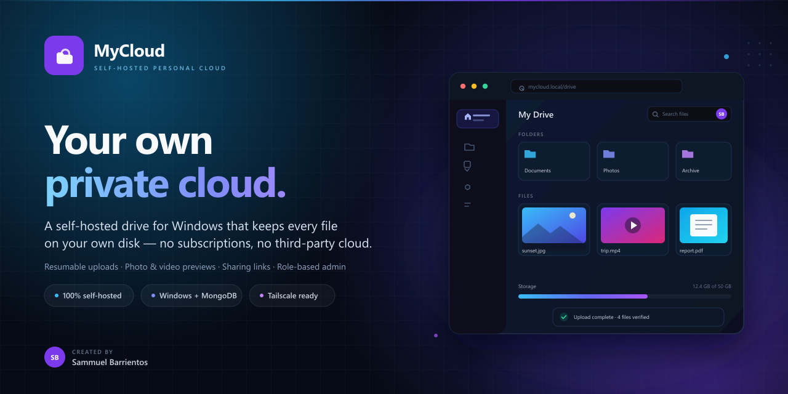

<p align="center">
  
</p>

<h1 align="center">MyCloud</h1>

<p align="center"><strong>Your own private cloud, on your own machine.</strong></p>

<p align="center">
  
  
  
  
  
</p>

<p align="center">Created by <strong>Sammuel Barrientos</strong></p>

MyCloud is a self-hosted personal cloud drive for Windows. It keeps your files on a disk you own and gives you a fast, modern web interface to reach them from your laptop, phone, or tablet. File bytes live in a plain storage folder, metadata lives in a local MongoDB database, and the app itself is served by Next.js on your own PC.

No subscriptions, no storage caps, and no files sitting on someone else's servers. MyCloud is designed for a trusted home network, with optional private phone access over Tailscale. It is **not** intended for direct exposure to the public internet.

> [!WARNING]
> **Security notice**
>
> This build is pinned to **Next.js 14.2.5**. `npm audit --omit=dev` reports **5 production advisories**, including critical advisories against Next.js. A non-breaking patch upgrade exists (`next@14.2.35`). Do not expose MyCloud directly to the internet. Prefer Tailscale Serve or a trusted LAN, and read [Known dependency advisories](#known-dependency-advisories) before storing irreplaceable data.

## Highlights

- **Self-hosted and private** - your files stay on your hardware, under your rules.
- **Fast, resumable uploads** - 32 MiB chunks, four in parallel, SHA-256 verified by the server.
- **A complete file browser** - folders, breadcrumbs, grid/list views, search, stars, recent files, multi-select, drag and drop, and a recycle bin.
- **Media-friendly** - photo and video galleries, Range streaming, PDF/text previews, and local thumbnails via `sharp` and FFmpeg.
- **Sharing when you want it** - internal viewer/editor shares plus public links that are off by default and support expiry, passwords, and revocation.
- **Windows-first deployment** - Start/stop scripts, NSSM service support, Tailscale Serve setup, firewall helpers, and tested backup/restore scripts.

## What MyCloud does

- **Accounts and roles** - admin/user roles, admin-created accounts, forced first-login password change, bcrypt password hashing, database-backed sessions that can be revoked, and per-IP/per-account login rate limiting.
- **File browser** - folder tree, breadcrumbs, grid/list views, sorting, search, filters, multi-select, drag and drop, stars, recent files, shared-with-me, recycle bin, restore, permanent delete, rename, move and copy.
- **Uploads** - chunked resumable uploads (32 MiB chunks by default, four chunks in parallel), server-side SHA-256 verification, per-user quotas, disk-space checks, magic-byte inspection, extension allowlist and dangerous-file denial.
- **Downloads and previews** - full downloads, HTTP Range streaming for video and audio, image/video/audio/PDF/text previews, photo and video galleries, local thumbnails via `sharp` and FFmpeg.
- **Sharing** - internal viewer/editor shares and public links. Public sharing is **off by default**. Links can have an expiry, a bcrypt-hashed password, a download toggle, and can be revoked. Passwords are exchanged for a signed HttpOnly access cookie.
- **Administration** - user creation/deactivation, quotas, forced password resets, system settings, audit log, and a sanitized health dashboard.
- **Deployment** - local-only MongoDB, NSSM Windows service, Tailscale Serve private HTTPS, firewall helper, backup/restore PowerShell scripts, scheduled-backup wrapper, health check.

## Architecture at a glance

```text
Browser / phone
      |
      | HTTPS on your tailnet (Tailscale Serve) or private LAN
      v
Next.js 14.2.5 (127.0.0.1:3000)
  |-- App Router pages + React UI
  |-- Route Handlers (auth, files, uploads, shares, admin)
  |-- background worker (thumbnails, cleanup)
  |
  +--> MongoDB 8 on 127.0.0.1:27017   metadata only
  +--> C:\MyCloudStorage               file bytes, UUID names
  +--> FFmpeg / ffprobe + sharp        local media processing
```

File bytes are **never** stored in MongoDB. Database records contain an opaque relative path such as `files/<ownerId>/2026/11/<uuid>.blob`; original filenames are display metadata only. Absolute server paths and the MongoDB URI are not returned to non-admin clients, and the admin health endpoint redacts them too.

## Requirements

| Component | Minimum / recommended |
| --- | --- |
| Windows | Windows 10 or 11, 64-bit, NTFS |
| Node.js | 20.11 or newer (verified on Node 24.18.0) |
| MongoDB | MongoDB Community Server 8.0, bound to `127.0.0.1` |
| MongoDB Database Tools | For backup/restore (`mongodump`, `mongorestore`) |
| Disk | Separate data disk recommended; enough space for files + backups |
| FFmpeg | Bundled `ffmpeg-static` / `ffprobe-static`, or a local FFmpeg 6+ build |
| Remote access | Tailscale (recommended) or a trusted private LAN |
| Service | NSSM 2.24+ for running as a Windows service |

## Quick start

### 1. Get the code and install

```powershell
git clone https://github.com/<your-username>/MyCloud.git
Set-Location MyCloud
npm install
```

### 2. Configure

```powershell
Copy-Item .env.example .env.local
npm run generate-secret    # paste the output into AUTH_SECRET in .env.local
notepad .env.local         # set MONGODB_URI, MYCLOUD_STORAGE_PATH, AUTH_URL
```

MongoDB must already be running before the next step.

### 3. Initialize, create an admin, and start

```powershell
npm run setup
npm run setup:admin
npm run build
npm start
```

Then open <http://127.0.0.1:3000> and sign in with the administrator you just created.

If the project is already built and configured on your machine, you can start it directly with `npm start`; re-run `npm run setup` only after changing storage or database settings.

For an always-on deployment, install MongoDB and MyCloud as Windows services and publish the app through Tailscale - see [docs/TUTORIAL.md](docs/TUTORIAL.md). For everyday offline use on the original laptop, see [docs/RUN-OFFLINE.md](docs/RUN-OFFLINE.md).

Starting from a completely fresh machine? The full tutorial covers Node.js, MongoDB, Database Tools, FFmpeg, environment configuration, the initial admin, NSSM, Tailscale, firewall rules, scheduled backups, restore, upgrades and troubleshooting.

## Deployment snapshot

The project was developed and verified on a Windows installation with Node.js 24.18.0 and portable MongoDB 8.0.34:

- Storage lives on an internal SSD, with backups on a separate disk.
- Uploads use 32 MiB chunks with four chunks in parallel; a local 1 GiB benchmark reached 360 MiB/s upload and 242 MiB/s end-to-end.
- The app starts at Windows sign-in through `Start-MyCloud.cmd`; MongoDB is started by the same script.
- Runtime modes: loopback for Tailscale Serve, or `0.0.0.0:3000` for a trusted LAN. Public sharing is disabled by default.
- `npm run typecheck`, `npm run lint`, `npm test` (63 tests), `npm run build` and `npm run healthcheck` pass.
- NSSM service installation and Tailscale Serve are documented but optional for laptop use.

See [docs/RUN-OFFLINE.md](docs/RUN-OFFLINE.md) for the exact start/stop and auto-start setup of that installation.

## Scripts

| Command | Purpose |
| --- | --- |
| `npm run dev` | Development server on `127.0.0.1:3000` |
| `npm run build` | Production build |
| `npm start` | Production server on `127.0.0.1:3000` |
| `npm run start:lan` | Production server on `0.0.0.0:3000` (trusted LAN only; firewall required) |
| `Start-MyCloud.cmd` | Start MongoDB if needed, start MyCloud, verify health and open the browser |
| `Stop-MyCloud.cmd` | Stop the MyCloud web server (add `-IncludeMongo` to stop MongoDB too) |
| `npm run setup` | Validate configuration, create storage folders, connect to MongoDB, synchronize indexes |
| `npm run setup:admin` | Interactively create an administrator; password is hidden while typing |
| `npm run generate-secret` | Generate a 48-byte URL-safe `AUTH_SECRET` |
| `npm run worker` | Standalone thumbnail/maintenance worker (only when `MYCLOUD_DISABLE_WORKER=true`) |
| `npm run healthcheck` | Call `/api/health`; exits non-zero if degraded |
| `npm run typecheck` | TypeScript checks |
| `npm run lint` | Next.js ESLint |
| `npm test` | Vitest unit tests |
| `npm run backup` | Storage + MongoDB backup with manifest and retention |
| `npm run restore -- -Source <folder>` | Storage + MongoDB restore; stop the app first |
| `npm run install-service` | Install/reconfigure the NSSM Windows service (elevated) |
| `npm run setup:tailscale` | Publish `127.0.0.1:3000` on the tailnet with HTTPS |
| `npm run setup:firewall` | Block inbound MongoDB; optionally allow LAN web access (elevated) |

Additional scripts:

- `scripts\scheduled-backup.ps1` - stops the `MyCloud` service, runs a consistent backup, restarts the service.
- `scripts\install-backup-task.ps1` - registers the scheduled backup in Task Scheduler (elevated).
- `scripts\install-service.ps1` - defaults to loopback (`127.0.0.1`) for Tailscale; pass `-BindAddress 0.0.0.0` for direct LAN access.

## Configuration

Copy `.env.example` to `.env.local` and replace every placeholder. `.env.local` contains `AUTH_SECRET`; never commit it, paste it into a chat, or put it in an unencrypted backup.

Required settings:

| Variable | Meaning |
| --- | --- |
| `AUTH_SECRET` | At least 32 random characters; generate with `npm run generate-secret` |
| `MONGODB_URI` | Keep local: `mongodb://127.0.0.1:27017/mycloud` |
| `MYCLOUD_STORAGE_PATH` | Absolute dedicated folder, for example `C:\MyCloudStorage`. Never a drive root. |
| `AUTH_URL` | Exact public origin, for example `https://mycloud.tailnet-name.ts.net` |
| `AUTH_TRUST_HOST` | `true` when using Tailscale Serve / a local reverse proxy |

Optional settings:

| Variable | Default | Meaning |
| --- | --- | --- |
| `MYCLOUD_MAX_UPLOAD_BYTES` | 20 GiB | Maximum single-file size |
| `MYCLOUD_CHUNK_SIZE_BYTES` | 32 MiB | Upload chunk size (256 KiB - 64 MiB); four chunks upload in parallel |
| `MYCLOUD_DEFAULT_QUOTA_BYTES` | 0 | New-user quota; 0 = unlimited |
| `MYCLOUD_TEMP_UPLOAD_HOURS` | 24 | Lifetime of incomplete upload sessions |
| `MYCLOUD_SESSION_DAYS` | 7 | Login session lifetime (1-30 days) |
| `MYCLOUD_TRASH_RETENTION_DAYS` | 30 | Recycle-bin retention |
| `MYCLOUD_ALLOWED_EXTENSIONS` | built-in list | Comma-separated extension allowlist override; dangerous types are still denied |
| `MYCLOUD_BACKUP_PATH` | `backups-local` | Default backup destination; must be outside storage |
| `MYCLOUD_DISABLE_WORKER` | `false` | Set `true` only when running `npm run worker` separately |
| `MYCLOUD_FFMPEG_PATH`, `MYCLOUD_FFPROBE_PATH` | auto-detect | Explicit media binary paths |
| `MYCLOUD_APP_NAME` | `MyCloud` | UI display name |
| `MYCLOUD_LOG_LEVEL` | `info` | `debug`, `info`, `warn`, `error` |
| `MYCLOUD_TRUST_FORWARDED_HEADERS` | `true` | Trust `X-Forwarded-*` only from a local proxy |

## Data and backup layout

```text
C:\MyCloudStorage\
  files\<ownerId>\<YYYY>\<MM>\<uuid>.blob
  thumbnails\<ownerId>\<uuid>.webp
  previews\...
  temp\uploads\<ownerId>\<uploadId>\part-000000

D:\MyCloudBackups\mycloud-YYYYMMDD-HHMMSS\
  storage\...            copy of the storage tree (temp excluded)
  mongo.archive.gz       compressed MongoDB dump
  manifest.json          backup metadata
```

Back up the storage tree and MongoDB together: the database references opaque files, so restoring only one side leaves dangling records or orphan files. The backup script copies both and writes a manifest.

## Known dependency advisories

`npm audit --omit=dev` currently reports 5 production vulnerabilities:

| Package | Severity | Advisory summary | Available fix |
| --- | --- | --- | --- |
| `next` 14.2.5 | critical | Multiple Next.js advisories (cache poisoning, DoS, image-optimizer issues, SSRf/RCE classes). | `next@14.2.35` is a non-breaking patch within 14.2. |
| `sharp` 0.33.5 | high | Inherited libvips/libheif/librsvg issues. | `sharp@0.35.5` is a semver-major upgrade. |
| `zod` 3.25.76 | high | Memory exhaustion when validating oversized constrained collections. | `zod@4.6.7` is a semver-major upgrade. |
| `postcss` (via Next) | high | Source-map / CSS stringify issues. | Fixed by `next@14.2.35`. |
| `file-type` 19.6.0 | moderate | Infinite loop in the ASF parser on a malformed file. | `file-type@22.3.0` is a semver-major upgrade. |

Mitigations already in this application:

- No use of `next/image`; the image optimization endpoint is not used by the UI.
- No `middleware.ts`; authorization is enforced inside every page and Route Handler.
- No Next.js Server Actions; mutations use explicit Route Handlers with CSRF checks and Zod validation.
- Uploads are limited in size and chunk count, and inspected before being stored.
- The app binds to loopback and is intended for private access only.

These mitigations reduce exposure but do not make the pinned version safe on the public internet. Before storing irreplaceable data or enabling access from untrusted devices, upgrade Next.js at minimum to `14.2.35` (same minor, low migration risk) and re-run `npm run typecheck`, `npm test`, `npm run build` and the smoke checklist in the tutorial. Major upgrades of `sharp`, `zod` and `file-type` require code changes and additional testing. The Next.js pin was intentional; changing it should be a deliberate, tested decision.

## Documentation

- [docs/RUN-OFFLINE.md](docs/RUN-OFFLINE.md) - everyday offline/LAN run guide, with start/stop and auto-start instructions.
- [docs/TUTORIAL.md](docs/TUTORIAL.md) - complete from-zero Windows deployment and activation guide.
- [docs/MIGRATION.md](docs/MIGRATION.md) - move an existing installation and its data to another always-on Windows PC.
- [docs/SECURITY.md](docs/SECURITY.md) - security model, controls, limitations and hardening checklist.
- [docs/ARCHITECTURE.md](docs/ARCHITECTURE.md) - components, data model, storage layout, request flows and worker behavior.

## Author

**Sammuel Barrientos** - creator and maintainer of MyCloud.

## License and ownership

Private project. © 2026 Sammuel Barrientos. All rights reserved. No license is granted for redistribution. Third-party dependencies retain their own licenses.
